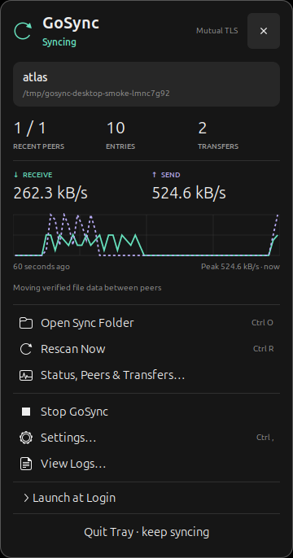
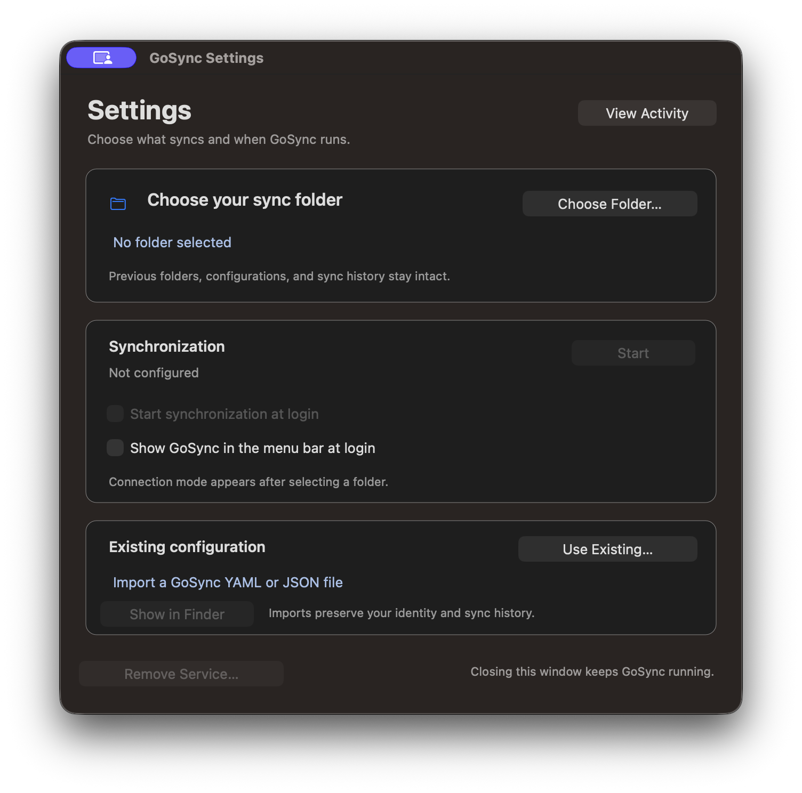
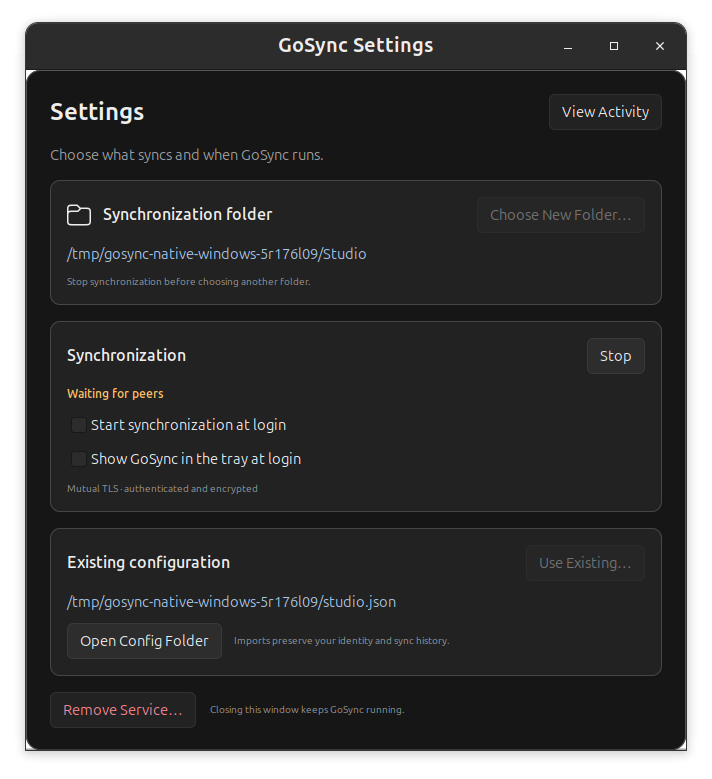
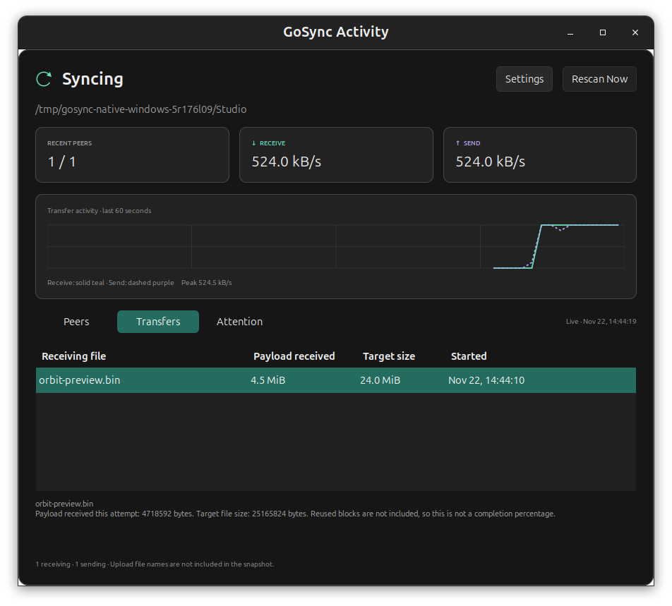
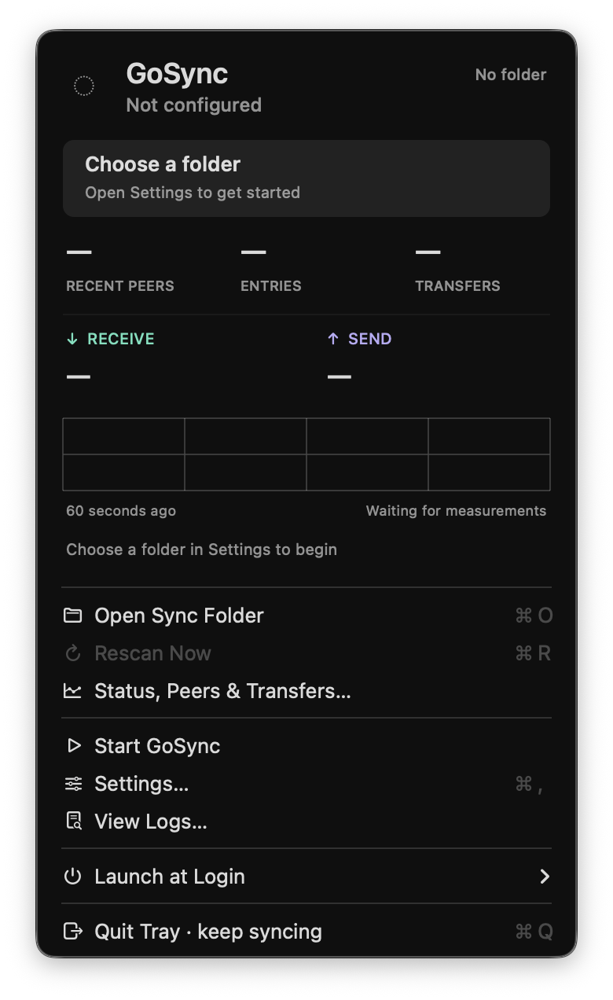
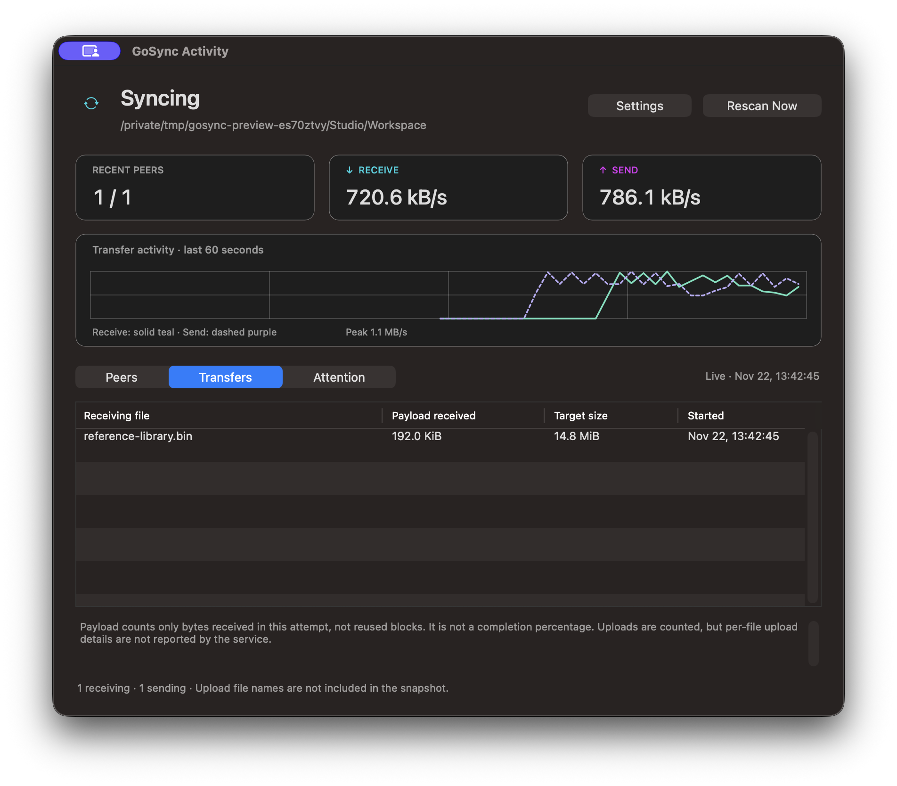

# GoSync Desktop

[← GoSync](../readme.md) · [Operating guide](GUIDE.md) · [Releases](RELEASING.md)

GoSync Desktop provides a native macOS menu-bar app and Ubuntu tray app. Its
per-user daemon is a separate process: **Quit Tray leaves synchronization running.**
Stop GoSync stops the whole daemon; there is no pretend Pause/Resume control.



*Genuine native GTK dashboard capture on an ARM64 Spark, using disposable folders
and a private mutual-TLS test group. This is the running dashboard, not a mockup.*

## Install

Copy into Terminal, then choose a folder in the app:

```sh
curl -fsSL https://raw.githubusercontent.com/TypeTerrors/go_sync/main/install.sh | bash
```

The installer chooses and verifies the native package. Ubuntu uses an
administrator prompt for package installation; the Mac app goes into your user's
Applications directory. Existing configuration and history are preserved.
[Installer options, updates and troubleshooting](INSTALLING.md).

For manual installation, download from [GitHub Releases](https://github.com/TypeTerrors/go_sync/releases).
Desktop packages are published by the merge release workflow.
Review builds are artifacts in **Actions → Native desktop builds**.

| Computer | Package |
|---|---|
| Apple Silicon Mac | `gosync-desktop-darwin-arm64.zip` |
| Intel Mac | `gosync-desktop-darwin-amd64.zip` |
| Ubuntu Intel/AMD | `gosync-desktop-linux-amd64.deb` |
| Ubuntu ARM64, including Spark | `gosync-desktop-linux-arm64.deb` |

Each desktop package has a `.sha256` checksum. The six CLI binaries and their
`SHA256SUMS` remain available separately and work without a desktop.

### macOS

Unzip in Finder, drag **GoSync.app** into **Applications** (or your user's
Applications directory), then open it. The icon appears in the menu bar, with
no Dock icon. Keep the app there: the LaunchAgent uses its bundled daemon.
macOS 12 or newer is required. Allow local-network access if requested.

These builds are **ad-hoc signed, not Developer ID signed or notarized**.
Gatekeeper may block a downloaded app. After verifying its source, use
**System Settings → Privacy & Security → Open Anyway** where macOS offers it.
Managed Macs may prohibit this exception. Do not disable Gatekeeper globally.
This signing limitation prevents claiming a frictionless consumer install.

macOS privacy controls may separately restrict Documents, Desktop, external
volumes, or other locations. Check Files and Folders permissions and daemon logs
when access is denied; compilation alone does not validate these permissions.

### Ubuntu

Open the `.deb` with a graphical package installer (App Center or GDebi), install,
then launch **GoSync** from Applications. Package installation uses the normal
administrator prompt. The synchronization service itself needs no root access.
Installing the package does not start synchronization or change your files.

Ubuntu 24.04+ is the build baseline. Required runtime components are a graphical
session, session D-Bus, systemd user services, `zenity`, and `xdg-utils`. On GNOME,
enable **Ubuntu AppIndicators** / **AppIndicator and KStatusNotifierItem Support**
in Extensions. The package recommends `gnome-shell-extension-appindicator`;
standard Ubuntu Desktop normally includes it. There is no GTK/libappindicator
development dependency: the tray uses StatusNotifier over D-Bus. Zenity supplies
confirmation and message dialogs at runtime. The package also installs
`python3-gi`, `python3-gi-cairo`, and `gir1.2-gtk-3.0` for the native GTK dashboard,
Settings, Activity, and folder/configuration pickers;
no pip environment is needed.

Choose **Open Dashboard** in the tray menu for the compact folder card, peer/entry/
transfer counters, teal receive and dashed purple send history, and service
controls. Tray hosts supporting activation also open it directly when clicked.
GNOME controls the AppIndicator menu, so the rich graph appears in a small native
window rather than inside that menu. The standard menu retains its quick actions.
The dashboard follows light/dark appearance and keeps its layout scrollable on
small screens. **Escape** or its close button hides only the dashboard; open it
again from the tray. **Ctrl+O**, **Ctrl+R**, **Ctrl+,**, and **Ctrl+Q** open the folder,
rescan, open Settings, and quit the tray respectively. Login settings are grouped
under **Launch at Login**. Quitting still leaves the daemon synchronizing.

## First launch

On both **macOS and Ubuntu**, a native Settings window opens on first launch.

1. Click **Choose Folder…** and use the native folder picker, or **Use Existing…**
   to import a YAML/JSON configuration.
2. For a new folder, read the LAN security disclosure and confirm setup. This
   creates a separate configuration and history. Existing files stay in place;
   **synchronization stays stopped until you click Start**, including after a
   tray relaunch. Canceling preserves the previous selection.
3. Click **Start** when ready to synchronize. Existing files will be published;
   remote edits and deletions can arrive. Keep a separate backup.
4. Choose **Start synchronization at login** and **Show GoSync in the tray at
   login** independently. Setup does not automatically enable either preference.

Stop synchronization before switching folders. Returning to a known folder reuses
its original configuration, identity, and history, including previously imported
configurations. For folders configured elsewhere with the CLI, first import their
original configuration. Importing does not rewrite it or start synchronization.
Overlapping folders and active state directories are rejected. If a previously
known configuration or folder is unavailable, restore it or use **Use Existing…**;
the picker will not silently initialize replacement history.





**Automatic LAN mode is unauthenticated and unencrypted.** Other peers in the
`gosync-lan` group can read and modify the selected folder. Use only on a trusted
LAN. There are no pairing codes. Existing mutual-TLS configurations keep their
certificates, keys, group, and history; invalid TLS never falls back to LAN mode.

Setup invokes the daemon's existing `init` command. New desktop folder profiles use
private `gosync/folders/workspace-*/config.json` files, with separate state beside
each file. This leaves earlier configurations and history intact. CLI default paths are
`~/.config/gosync/default.yaml` on Ubuntu (respecting `XDG_CONFIG_HOME`) and
`~/Library/Application Support/gosync/default.yaml` on macOS. `default.json` is
recognized if YAML is absent. The selected path is saved in `gosync/desktop.json`;
its backward-compatible `knownConfigs` list also remembers previously selected
configuration paths. These preferences do not rewrite daemon configurations or
contain key material.

## Reading the menu

Icon shapes and text distinguish stopped, starting, locally idle, transferring,
warnings, errors, and stale/unavailable status. macOS uses monochrome templates
that adapt to the menu bar; Linux uses colored icons.

On both platforms, a compact dashboard shows the selected folder, recent peers, tracked
entries, active transfers, and receive/send rates. A solid teal receive trace and
dashed purple send trace share an automatically scaled **60-second payload-rate
graph**. The peak label states that scale. Missing or stale measurements leave
gaps; restarting the daemon or changing the selected configuration resets the
history. The graph is held in memory only and follows the system's light/dark
appearance. Full paths and status explanations remain available as tooltips and
in **Status, Peers & Transfers**.

The desktop interfaces group independent startup preferences under **Launch at Login**.
On macOS, use **⌘O** to open the folder, **⌘R** to rescan, **⌘,** for Settings, and **⌘Q** to
quit the tray while keeping synchronization running. These shortcuts apply while
the menu is open; they are not global hotkeys.

**Locally idle does not prove all peers are fully synchronized.** A recently
reachable peer had a successful reconciliation within at least 30 seconds (longer
for slow configured scan intervals). This is not a live connection count or a
durability guarantee. Warnings take precedence over activity icons; transfer
counts remain visible. Tracked entries include directories, matching the engine's
existing `files` counter.

Rates use payload-counter deltas between timestamped snapshots. The first sample
and counter/session resets show no rate. Protocol overhead and reused blocks are
excluded. Transfer details distinguish payload received in this attempt from the
target size; they are not a completion percentage. Historical failure totals do
not become permanent synchronization errors.

Snapshots refresh about once per second. Running heartbeats older than five
seconds become unavailable. The tray reads metrics embedded in the same atomic
`status.json`, avoiding skew from a separately timed `metrics.json`. It never
opens Badger to read status and introduces no network control endpoint.

## Controls and existing CLI configurations

- **Open Sync Folder:** Finder or the desktop file manager.
- **Rescan Now:** existing acknowledged local rehash command; peer reconciliation
  continues separately.
- **Status, Peers & Transfers:** a live native Activity window on both platforms with Peers,
  Transfers, and Attention tables, the transfer graph, and Rescan. Select a row
  for the full peer identity, file path, or issue. Historical readings are labeled.
  Receive payload is not a completion percentage; upload counts are available,
  while per-file upload names are not. The same measured graph is used by the
  dashboard and Activity. Missing/stale snapshots never appear as live activity.
- **View Logs:** recent per-user daemon logs.
- **Settings:** choose a sync folder, import an existing configuration,
  start/stop synchronization, change login preferences, or remove service
  integration. No destructive history operations are offered.
- **Start / Stop GoSync:** current user's managed service only. Start waits for a
  fresh matching daemon heartbeat before reporting success.
- **Start synchronization at login** and **Show tray at login:** independent options.
- **Quit Tray:** closes only the UI.

To adopt a CLI installation, stop its foreground daemon or named service and
select its **existing configuration**. Retain the same state directory. Desktop
control requires an explicit `state-dir`: an omitted CLI default could otherwise
refer to a different database from a GUI working directory. Generated configs
already contain it. Remove a one-time `bootstrap` setting after initializing.
The tray refuses to start while another process holds the state lock; the daemon's
Badger lock remains the final protection against races. External CLI processes
are not stopped through the tray. This initial UI manages one selected service;
other CLI/named-service folders remain independent.

Ubuntu can adopt the original unmodified `deploy/gosync.service`, saving it as
`gosync.service.before-desktop` and restoring it on removal. Custom units and
`gosync@NAME` instances are not overwritten. Migrate custom service definitions
deliberately. Explicit state paths, legacy JSON, and mutual TLS are preserved.
YAML environment variables must also exist in the user-service environment;
shell-only variables are not automatically login-service variables. Use **Settings → Open Config Folder** to locate the config and edit explicit
paths with your editor. Stop before editing paths.

On Ubuntu, **Ctrl+1** opens Activity, **Ctrl+,** opens Settings, **Ctrl+R** requests
Rescan, **Ctrl+W** or **Escape** closes the current window, and **Ctrl+Q** quits
only the tray. These are window shortcuts, not global hotkeys. Closing Settings
or Activity leaves the tray and daemon running; reopen either from the tray or
navigate between the two windows.



## Background lifecycle and removal

Ubuntu uses `gosync.service` in the systemd user manager, SIGTERM for shutdown,
restart-on-failure, and journald. Running beyond logout depends on user lingering
and session policy; the tray does not change that policy.

macOS uses `~/Library/LaunchAgents/com.typeterrors.gosync.plist`, with launchd
supervision, SIGTERM, and `~/Library/Logs/GoSync/daemon.log`. A LaunchAgent ends
at logout; it is not a system-wide LaunchDaemon. Optional tray login startup uses
`com.typeterrors.gosync.tray.plist` independently.

Stop synchronization and quit the tray before replacing the app/package during
an update. Reopen and start afterward, preserving configuration and state.

To uninstall on either platform, choose **Settings → Remove Service…** and confirm.
This stops/removes the managed service, removes tray autostart, and quits the UI.
Then remove the Ubuntu package through its package manager or trash GoSync.app.
Do this before removing/moving the app, so the OS does not retry a missing binary.
Configuration, synchronized files, history, and logs remain. Discard them manually
only when you intend to lose that data.

## Troubleshooting

Missing Ubuntu icon: check the AppIndicator extension and session bus. Failed
start: inspect View Logs for a busy database, occupied port, invalid/expired TLS,
inaccessible folder, or missing environment variables. A service PID alone never
counts as healthy status. A broken existing config is not silently replaced;
use Settings to select the right file. To change roots, initialize and select a
separate config deliberately; deleting history is not a safe reset operation.

## Building and validation

`make desktop` builds on the target OS/architecture with Go 1.25.1+, a native C
compiler, and Python 3. Linux needs `dpkg-deb`; macOS needs Xcode Command Line
Tools (`sips`, `iconutil`, `codesign`, `plutil`, `ditto`). Artifacts land in `dist/`.
Ordinary CLI and Docker builds do not import the tray or dialog dependencies.

Native CI targets AMD64/ARM64 on Ubuntu and macOS. GUI adapters require the
`desktop` build tag. On Ubuntu, `xvfb-run -a /usr/bin/python3 scripts/test-dashboard.py`
also exercises real GTK widgets, action gating, theme rendering and window closure
without a physical desktop. Shared parsing, lifecycle, locking, and status tests are part
of the normal race suite. On Spark, native GNOME dialogs/menu actions were tested
for folder selection and security cancellation, adoption of an existing mutual-TLS
config, service start/stop/restart, real two-peer replication (including a 4 MiB
binary), rescan acknowledgement, logs, tray autostart registration, independent
tray exit, and removal preserving history. Tests used a private group, fresh
folders, and loopback peers; test services were removed afterward.

On an Apple Silicon Mac running macOS 26.6.2, native race tests, vet, packaging,
and real LaunchAgent/controller checks passed with disposable folders and two
loopback mutual-TLS peers. Checks covered start/stop/restart, disabled login
preference preservation, duplicate-state protection, broken TLS recovery, rescan,
bidirectional edits/renames/deletions, executable modes, a 12 MiB binary hash, and
growing-file arrival before the writer finished. Removing the managed integration
preserved configuration, files, and history. See the
[sanitized Mac report](results/native-macos-desktop.json) for execution methods
and remaining checks. Real Mac menu/dialog tests also passed: security cancellation,
TLS config adoption, start/stop, login toggles, live rates, rescan acknowledgement,
Finder/TextEdit/Console opening, Quit Tray with the same daemon still syncing,
relaunch without duplication, and removal preserving history. Two additional
20 MiB payloads converged byte-for-byte. The macOS CI jobs now run the full daemon
race suite too.



*Genuine capture of the single-icon header. The menu is shown unconfigured.*



The native Mac Settings and Activity windows were exercised on the MacBook:
folder-picker and confirmation cancellation, setup without starting a daemon,
mutual-TLS configuration import, Start/Stop, independent login preference,
peer/transfer/attention tabs, live graph and rows, Rescan, historical status,
window closure, and Quit Tray followed by a successful new transfer with the same
daemon PID. Two 24 MiB files converged by SHA-256. **⌘1** opens Activity, **⌘,**
opens Settings, **⌘W** closes the current window, and **⌘Q** quits only the tray
when a GoSync window is active. Closing either window leaves synchronization
running.

`sh scripts/test-macos-windows.sh` checks the production AppKit views with empty,
live, and historical data, service-action gating, table contents, light/dark
rendering, and window closure. It also covers JSON null history before the first
graph sample. The screenshots and interactive checks use the Mac's dark
appearance; light appearance has automated component rendering coverage.
See the [native window verification report](results/native-macos-windows.json).

The Ubuntu dashboard refresh was also exercised against two native mutual-TLS
loopback peers: real GTK start/stop, rescan and Ctrl+R, logs, login toggles,
close/reopen, and a new transfer after quitting the tray. Both directions of a
20 MiB binary transfer matched by SHA-256. Native widget tests cover light/dark
rendering and stale history; the genuine screenshot uses dark appearance.
See the [Ubuntu dashboard report](results/native-ubuntu-dashboard.json).
Wayland and other tray hosts were not exercised interactively.

The Ubuntu Settings and Activity windows were then exercised on Spark's real
GNOME X11 desktop with disposable mutual-TLS peers. Checks covered picker and
confirmation cancellation, stopped setup and relaunch, imported profile/history
reuse, Start/Stop, independent login toggles, every Activity tab and selected
row details, Rescan, stale-heartbeat recovery, close/reopen, and confirmed/canceled
service removal. Four 24 MiB binaries matched by SHA-256. Quitting the tray kept
the same daemon PID running; another 4 MiB binary transferred afterward. Test
integration was removed and test histories were archived without changing user
history. Genuine Settings and Activity captures above show this run.

Desktop race tests and vet, the ten GTK widget checks, native ARM64 packaging,
the full Go race suite/vet, and Docker regression/startup suites passed locally.
See the [Ubuntu window report](results/native-ubuntu-windows.json) for methods,
hashes, cleanup, and limits. The shared Go window logic is now tested on Linux;
its extraction has not yet been rerun natively on a Mac. Hosted CI for the prior
commit was rejected before runner startup for account payment/spending limits;
local validation does not replace the required hosted checks.

Actual logout/login, graphical DEB installation, and clean-machine Gatekeeper/privacy
prompts remain unverified. Local loopback tests do not establish Mac-to-Spark LAN
or mDNS behavior. Native controller tests and compilation do not substitute for
interactive menu testing.

Public macOS distribution needs an Apple Developer ID Application identity,
signing nested executables then the app with hardened runtime and timestamp,
`notarytool` submission, ticket stapling, and `codesign`/`spctl` validation on a
clean Mac. Signing credentials and notarization are not configured by this feature.
