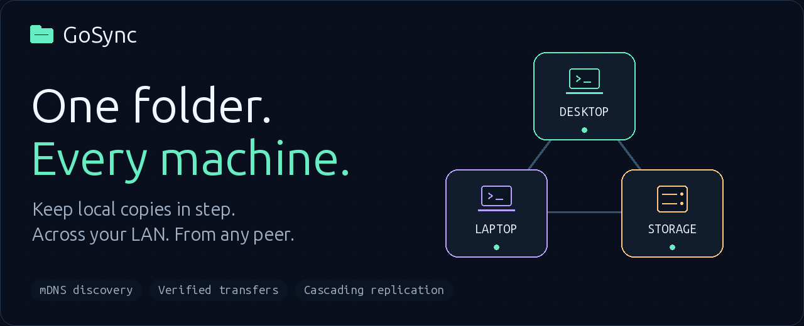
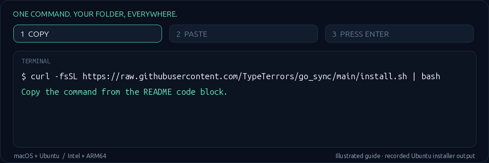
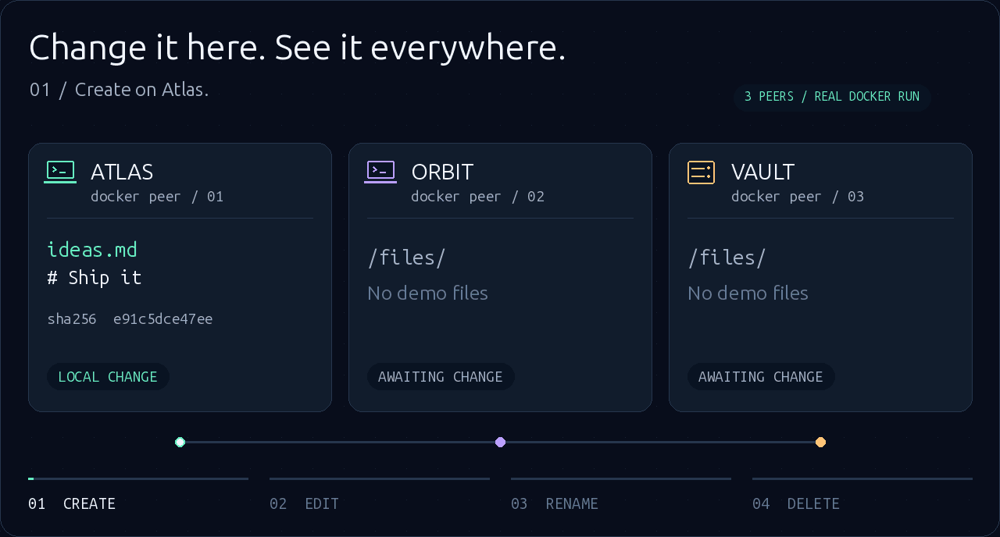
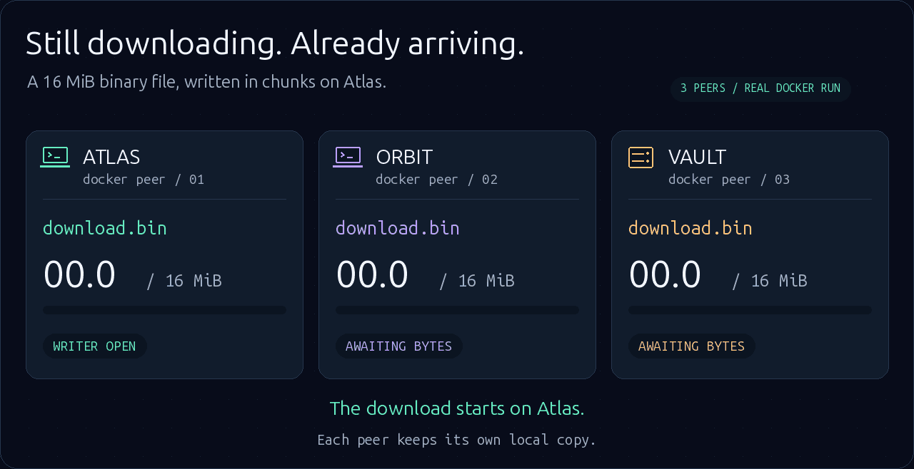
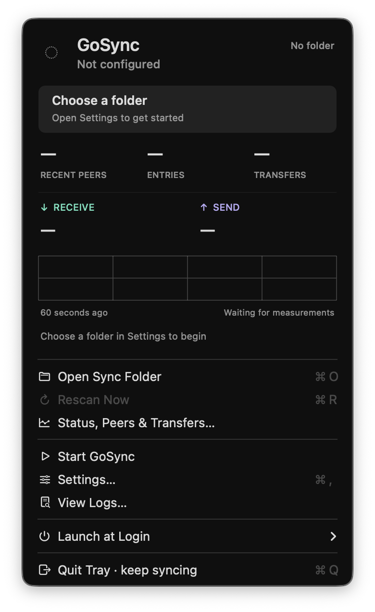
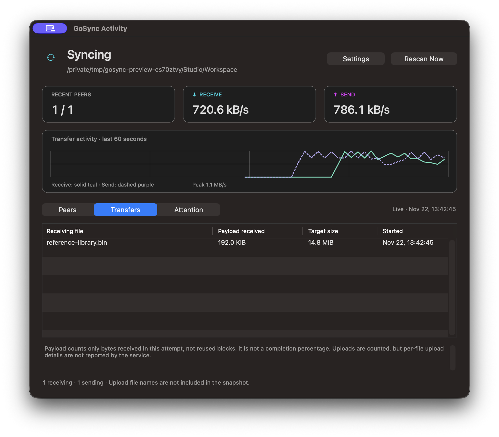
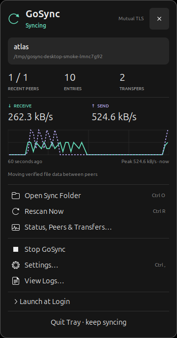
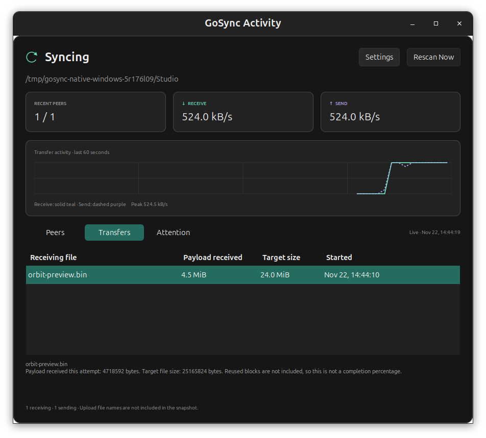
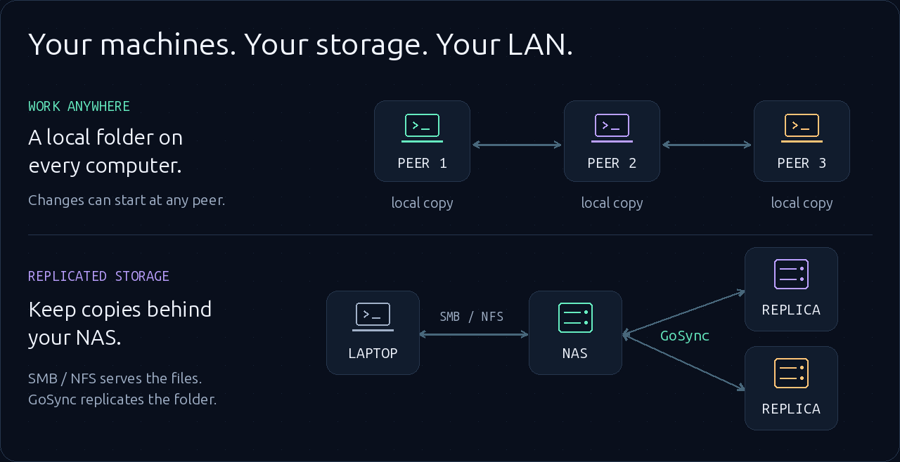

<p align="center">
  
</p>

<p align="center">
  <a href="LICENSE"></a>
  <a href="go.mod"></a>
  <a href="docs/GUIDE.md#trusted-lan-setup"></a>
  <a href="docs/results/README.md"></a>
</p>

## Install in one command

**Mac or Ubuntu? Copy this line into Terminal and press Enter.**

```sh
curl -fsSL https://raw.githubusercontent.com/TypeTerrors/go_sync/main/install.sh | bash
```

The installer detects your computer, verifies the download, and opens GoSync.
**Choose a folder. Start syncing.** No Go toolchain or peer addresses needed.

macOS 12+ · Ubuntu 24.04+ · Apple Silicon / ARM64 · Intel / AMD 64-bit

Ubuntu asks for your administrator password. Mac builds are currently ad-hoc
signed: macOS may require **Privacy & Security → Open Anyway**.
[Installation details, updates & alternatives](docs/INSTALLING.md)



*Illustrated copy/paste guide, with installer output recorded in an Ubuntu test
container. The app's folder chooser opens on your desktop.*
[Still image](docs/media/quick-install-poster.png) · [How this was made](docs/demo/README.md#installation-walkthrough)

<p align="center">
  <b>Edit anywhere. Sync while downloading. Keep a local copy on every peer.</b><br>
  GoSync discovers computers on your LAN and keeps their selected folders in sync.
</p>

<p align="center">
  <a href="#see-it-sync">See it sync</a> ·
  <a href="#on-your-mac">Mac app</a> ·
  <a href="#on-ubuntu">Ubuntu app</a> ·
  <a href="#build-your-own-setup">Your setup</a> ·
  <a href="#get-started">Get started</a> ·
  <a href="#go-deeper">Documentation</a>
</p>

## See it sync

Create a file on **Atlas**. Edit it on **Orbit**. Rename it on **Vault**.
The change follows you to the other machines, including when you delete it.



*Actual three-container GoSync run, using mDNS and mutual TLS. The display visualizes
recorded file states; GoSync itself is a headless service. Playback is slowed for
readability.* [Still image](docs/media/three-peers-poster.png) · [Reproduce the demo](docs/demo/README.md)

| ✏️ Work from any peer | 🌊 Start sharing sooner | 🌿 Grow beyond two machines |
|:---|:---|:---|
| Code, photos, music, binaries. Create, edit, rename, and delete regular files. | Growing downloads replicate as verified prefixes while the source is still writing. | Cascading transfers let peers relay content. Ten-peer operation is tested. |

### Still downloading. Already arriving.

A large download starts on one machine. The others begin receiving it **before the
writer closes**. When it finishes, every copy has the same bytes.



*Recorded local file sizes from the same Docker run, with slower playback. The demo
knows its planned 16 MiB size; applications can use an explicit completion marker
when they need to distinguish a partial download from a finished file.*
[Still image](docs/media/growing-download-poster.png) · [Transfer behavior](docs/GUIDE.md#transfer-and-recovery-behavior)

## On your Mac

**A small menu. A clear picture of your sync.** See recent peers, active transfers,
and a minute of receive/send activity without opening a terminal. Open your folder,
rescan, or manage the background service from the same menu.



*The updated menu before a folder is configured. Quit Tray keeps the background
service running.*

**Native Settings and live Activity.** Choose a folder with Finder's picker,
import an existing configuration, and control startup from a proper Settings
window. Activity shows peers, receiving files, and issues in live tables alongside
the same measured transfer graph.



*Captured from the running Mac app with disposable, mutually authenticated
loopback peers. Both 24 MiB files converged byte-for-byte. Receive counters measure
payload in the current attempt, not completion percentages. Per-file upload
names are not available; the active upload count is shown.*

[See Settings](docs/media/desktop-macos-settings.png) · [Install the Mac app](docs/DESKTOP.md#macos) · [Read the menu](docs/DESKTOP.md#reading-the-menu)

## On Ubuntu

The Ubuntu tray opens a compact native dashboard in the same style: your folder,
peer and transfer counts, and a live 60-second activity graph. Native controls
open files and logs, rescan, and manage the background service. Closing the
dashboard or quitting the tray leaves synchronization running.



*Captured from the running Ubuntu app with disposable, mutually authenticated
peers. GNOME's AppIndicator menu opens this GTK dashboard; other tray hosts may
open it directly on activation.* [Install on Ubuntu](docs/DESKTOP.md#ubuntu)

**Native Settings and live Activity.** Choose a folder with the GTK picker, import
an existing configuration, and control synchronization and tray login separately.
Activity has live Peers, Transfers, and Attention views with full row details and
the same measured graph. Closing either window keeps synchronization running.



[See Ubuntu Settings](docs/media/desktop-ubuntu-settings.png) · [Desktop guide](docs/DESKTOP.md)

## Build your own setup



**Your workspace, on every computer.** Put a GoSync peer beside each local folder.
Work on one machine, let the changes arrive, then pick up on another. Each computer
keeps a full copy. Disconnected peers catch up when they reconnect; concurrent
edits are preserved as conflicts for you to resolve.

**Replicated storage behind a NAS.** Serve a folder through your existing SMB or
NFS service and use GoSync to keep copies on other storage machines. A replica can
also be a computer you work on. This supplies the replication layer: pooled
capacity, a single shared mount, and automatic NAS failover need separate services.

## What comes with it

| Feature | What it does |
|:---|:---|
| **LAN discovery** | Finds peers with mDNS. Explicit peer addresses work where multicast is unavailable. |
| **Simple LAN setup** | Select a folder once. Saved YAML configuration and mDNS handle subsequent starts and peer discovery. Optional mutual TLS provides authenticated connections. |
| **Verified transfers** | Hash-checked snapshots become visible atomically on receivers. Text and binary files use the same transfer path. |
| **Incremental updates** | Reuses matching fixed-size blocks for edits and appends, with resumable interrupted transfers. |
| **Cascading distribution** | A preferred relay tree with default fanout two spreads upload work; fallback handles missing relays. |
| **Conflict recovery** | Preserves concurrent versions, remembers deletions, and offers history, inspection, and restore commands. |
| **Project-friendly folders** | Shared `.gosyncignore` rules, nested directories, dotfiles, and executable permissions. |
| **Operational controls** | Transfer limits, upload throttling, status, rescans, saved configuration, Docker, and a Linux user service. |

## Get started

**Prefer a desktop app?** [Install in one command](#install-in-one-command). GoSync Desktop offers a macOS menu-bar app and Ubuntu
tray controls: choose a folder, see activity, and manage synchronization without
a terminal. [Desktop installation](docs/DESKTOP.md) covers package availability,
dependencies, and current macOS signing limitations.

To build the service from source, install **Go 1.25.1+**:

```sh
git clone https://github.com/TypeTerrors/go_sync.git
cd go_sync
make build
```

**Choose a folder once, then start GoSync.** Run this on each computer:

```sh
./gosync init --sync-folder "$HOME/Shared"
./gosync
```

Local folder paths can differ. GoSync saves a YAML configuration and private state,
then automatically discovers other peers in the default LAN group. No peer
addresses, pairing codes, or certificates are needed. Existing files in the
selected folder are included. On later starts, run just `gosync` (or `./gosync`
when using the local build).

The automatic LAN mode uses unencrypted, unauthenticated connections. It joins
other instances in the same LAN group; mutual TLS remains an optional setup below.
See [simple startup](docs/GUIDE.md#simple-lan-startup) for configuration locations,
YAML/environment settings, and background startup.

**Try the three-peer demo locally.** With Docker Compose and Python 3 installed:

```sh
python3 docs/demo/capture.py
```

This builds the current code, starts three disposable containers, runs the file
operations above, verifies the results, and removes its containers and network.
It uses fresh test folders and identities. The [demo guide](docs/demo/README.md)
explains how to regenerate the GIFs.

<details>
<summary><b>Optional: authenticated, encrypted peers with mutual TLS</b></summary>

On a provisioning machine, create a private authority and a separate identity
bundle for each peer. Keep these outside your repository:

```sh
./gosync trust init --out "$HOME/gosync-setup/authority"
./gosync trust issue --authority "$HOME/gosync-setup/authority" \
  --name atlas --out "$HOME/gosync-setup/atlas-identity"
./gosync trust issue --authority "$HOME/gosync-setup/authority" \
  --name orbit --out "$HOME/gosync-setup/orbit-identity"
```

Transfer each peer's own identity bundle to that machine through a trusted
channel. Keep the authority's signing key private. On Atlas, create a configuration
for a fresh, empty shared folder:

```sh
./gosync init --config "$HOME/gosync-setup/gosync.json" \
  --sync-folder "$HOME/Shared" --state-dir "$HOME/gosync-state" \
  --identity "$HOME/gosync-setup/atlas-identity" --folder-id studio
./gosync --config "$HOME/gosync-setup/gosync.json"
```

Repeat on Orbit with `orbit-identity` and the **same folder ID**. Add more peers the
same way. Each peer needs its own persistent state directory outside the shared
folder. mDNS finds peers; their certificates authorize access.

Starting with existing files? Choose the appropriate [bootstrap policy](docs/GUIDE.md#run).
See the [operating guide](docs/GUIDE.md) for explicit addresses, certificate handling,
Docker deployment, and background services.

</details>

## Tested, with evidence

The [recorded qualification](docs/results/README.md) includes **70 Docker checks**
across files, secure operations, and faults; **ten peers** originating both static
and growing transfers; and **20 checks on two physical Linux machines** over a
wired LAN with mDNS and mutual TLS.

Linux amd64 and arm64 have native LAN coverage. Apple Silicon macOS has
[native LaunchAgent and two-peer loopback coverage](docs/results/native-macos-desktop.json).
Mac-to-Linux LAN, native Windows runtime, a three-machine physical LAN run, and
longer soak tests remain open. [Measurements and limits →](docs/PERFORMANCE.md)

GoSync is an evolving project with **eventual consistency**. Allow synchronization
to finish before switching machines when you need the latest version. Deletions
propagate too, so keep independent backups. Symlinks, special files, ACLs, and
extended attributes are outside the current mirrored file model.

## Go deeper

| | |
|:---|:---|
| [**Operating guide**](docs/GUIDE.md) | Configuration, trust, file semantics, conflicts, recovery, and service deployment |
| [**Releases**](docs/RELEASING.md) | Merge tags, downloadable builds, checksums, and release automation |
| [**Performance & scaling**](docs/PERFORMANCE.md) | Delta transfer costs, relay measurements, resource limits, and validation boundaries |
| [**LAN testing**](docs/LAN_TESTING.md) | Repeatable two- and three-machine validation |
| [**Qualification reports**](docs/results/README.md) | Saved Docker and native LAN results |
| [**Roadmap**](docs/ROADMAP.md) | Implementation epics and acceptance criteria |
| [**Demo source**](docs/demo/README.md) | Real Docker capture, recorded observations, and reproducible artwork |

For development: `make test` runs race checks, `make integration` runs the
three-peer regression suite, and `make qualification` runs the full Docker matrix.
See the [build and test guide](docs/GUIDE.md#build-and-test) for prerequisites.

Licensed under the [Apache License 2.0](LICENSE).
